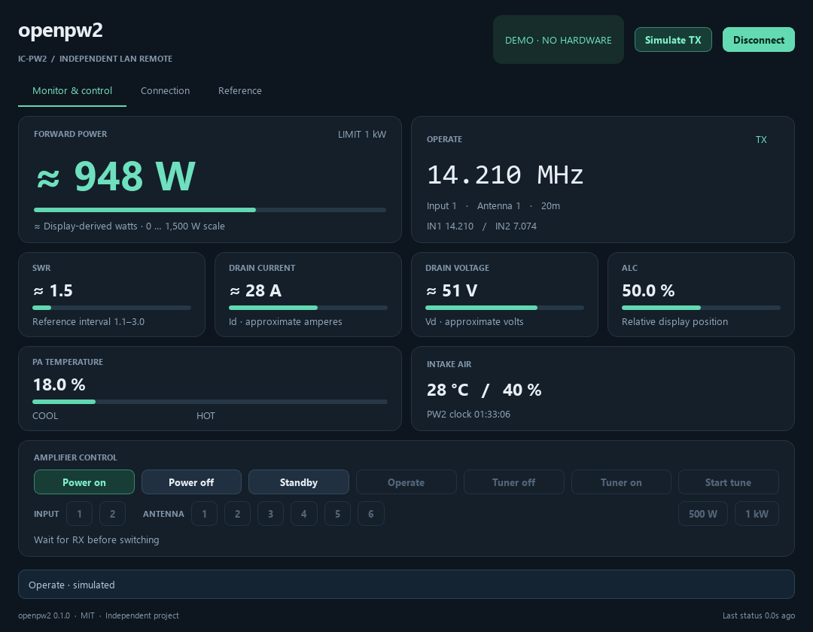

# openpw2

A small, independent Python desktop remote for the **Icom IC-PW2**, and a
readable reference implementation of its native **RS-PW2 LAN protocol**.



**MIT licensed. No HamRig installation, vendor application or vendor DLL needed.**
The client library depends only on `cryptography`; the optional GUI uses PySide6.
This is an independent interoperability project, not an Icom product.

## Start

Python 3.11 or newer. In this directory:

```powershell
python -m venv .venv
.venv\Scripts\python -m pip install -e ".[gui]"
.venv\Scripts\python -m openpw2
```

On Linux/macOS use `.venv/bin/python`. Tk is not required. Windows is the
initial tested platform; the source is portable but other OSes are not yet
validated. For a hardware-free preview:

```powershell
.venv\Scripts\python -m openpw2 --demo
```

In demo mode, select **Operate**, then **Simulate TX** to animate the meters.
The simulator never opens a network connection. Normal startup is disconnected.

For a real amplifier, open **Connection**, enter its address, user ID/password
and AC supply, then connect. TCP port defaults to **50200**. Disconnect the
original RS-PW2 application and any other PW2 LAN controller first: a competing
client can replace the session. No existing application or service is stopped
automatically. Passwords are memory-only; host, port, user ID and supply setting
are saved under `%APPDATA%/openpw2/settings.json` (or `~/.config/openpw2`).

Use bar view on the PW2 to receive all six meters. A long press on its meter
display switches between needle and bar views. The application currently
does not change that view remotely.

## Implemented

- LAN login with the current device challenge; framed TCP status stream.
- Explicit power on/off, Operate/Standby, tuner bypass/enable and Start tune.
- Input 1/2, direct antenna 1–6 selection, 500 W / 1 kW limit.
- RX/TX, tuning, protection lamp, frequencies, selected routing and device clock.
- Six meter bars; approximate watts, amperes, volts and SWR where supported.
- Actual numeric **intake air** temperature/humidity, separate from the relative
  PA COOL–HOT indication.
- Interlocks for stale/unknown state, TX, tuner busy and protection. 1 kW
  switching requires a configured 180–264 V AC supply. Standby remains a release.
- A reference tab with live telemetry JSON and credential-free snapshot export.
- A local simulator and automated protocol/GUI tests.

Controls are absolute setters even though the wire protocol uses button
events. A repeated request for an already selected setting sends nothing. Power
requests are explicit on/off messages and return an acceptance acknowledgement.
The client does not automatically reconnect, resend uncertain button presses,
power on, tune or generate RF. TUNE starts a cycle only after an explicit click;
its acknowledgement is not a successful-match result.

## Evidence and limits

Protocol behavior comes from independent implementation work against RS-PW2
1.0.4 and operator-controlled hardware observations on 2026-10-07. Login,
telemetry and initial power-on were exercised by the earlier implementation.
Other controls have captured original-app sequences and synthetic-server tests.
**A direct hardware acceptance run of every command from openpw2 itself is
still pending.** A passing simulator test is not a hardware acceptance claim.

`≈` marks estimates derived from display scales. These are not raw CI-V meters
or precision measurements. SWR is currently estimated only within the measured
1.1–3.0 interval. Above it the app keeps the relative bar and leaves numeric
SWR unknown. Needle view and non-normal pages do not supply all six readings.

Not implemented: detailed protection messages/reset, LAN band writes, remote
meter-page changes, SO2R/dual-receive control, menu editing, DPD controls,
firmware/configuration operations or USB/CI-V transport. See the
[feature and evidence matrix](docs/status.md) for exact distinctions.

## Reference for implementers

| Document | Contents |
|---|---|
| [Protocol](docs/protocol.md) | Byte order, framing, authentication, command handshakes and display offsets |
| [Measurement interpretation](docs/measurements.md) | Scale anchors, observed references, uncertainty and missing values |
| [Python API](docs/api.md) | Async usage, commands, snapshots and error semantics |
| [Architecture](docs/architecture.md) | Modules, threading, lifecycle and extension points |
| [Status & validation](docs/status.md) | Evidence levels, unsupported features and hardware acceptance procedure |
| [Contributing](CONTRIBUTING.md) | Tests, sanitized fixtures, formatting and packaging |
| [Third-party notices](THIRD_PARTY.md) | Dependencies and source provenance |
| [Deutsch: Kurzstart](docs/quickstart-de.md) | Bedienung und Installation auf Deutsch |

```python
import asyncio
from getpass import getpass
from openpw2 import Client, ConnectionConfig


async def main():
    config = ConnectionConfig("192.0.2.10", "YOUR_USER_ID", getpass("PW2 password: "), mains_v=230)
    async with Client(config) as pw2:
        print(pw2.snapshot)
        # An explicit command, when you intend to change the amplifier:
        # await pw2.command("antenna", n=2)


asyncio.run(main())
```

## Develop / package

```powershell
.venv\Scripts\python -m pip install -e ".[gui,dev]"
.venv\Scripts\python -m pytest -q
.venv\Scripts\python -m ruff check .
.venv\Scripts\python -m build
.venv\Scripts\python tools/build_desktop.py
```

The desktop build is a portable folder `dist/openpw2/` with `openpw2.exe`
on Windows. Keep its `_internal` directory alongside it. No Windows service
or administrator privileges are required. The build includes dependency
license texts; see `THIRD_PARTY.md`. Nothing is published automatically.
